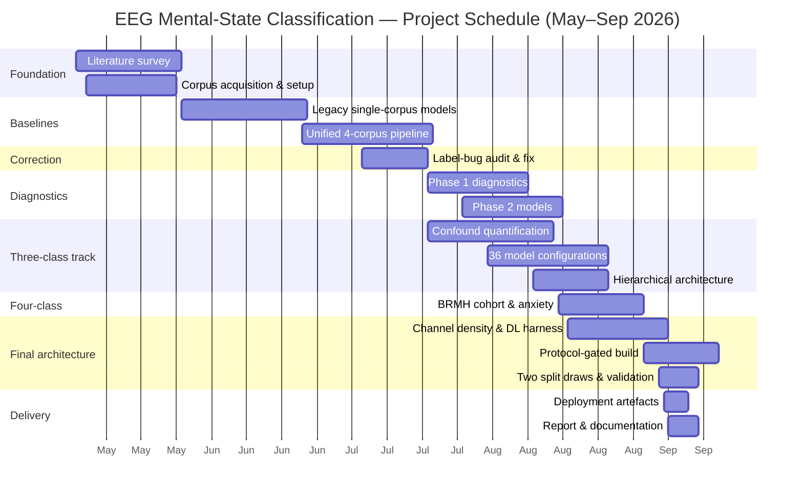
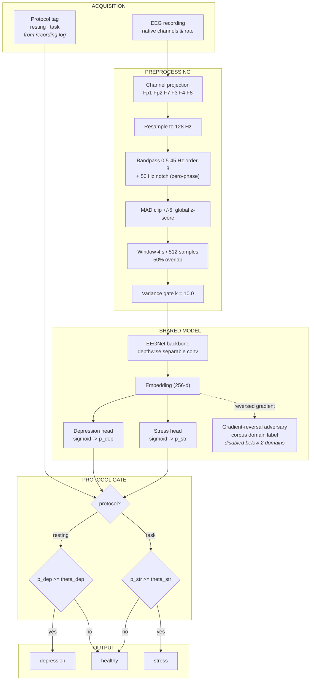
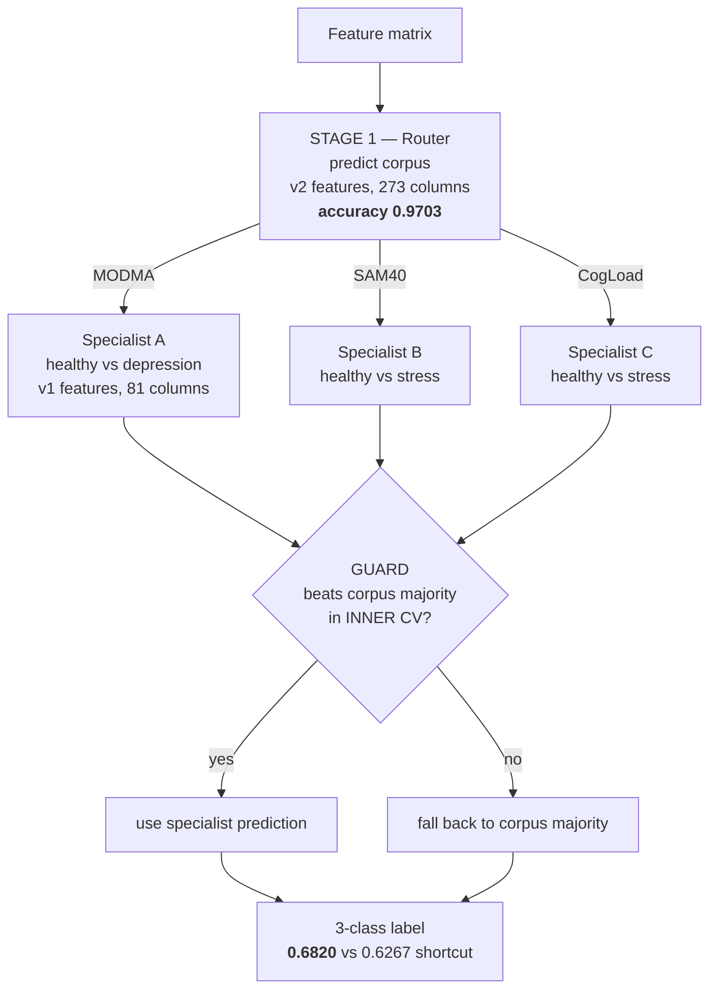
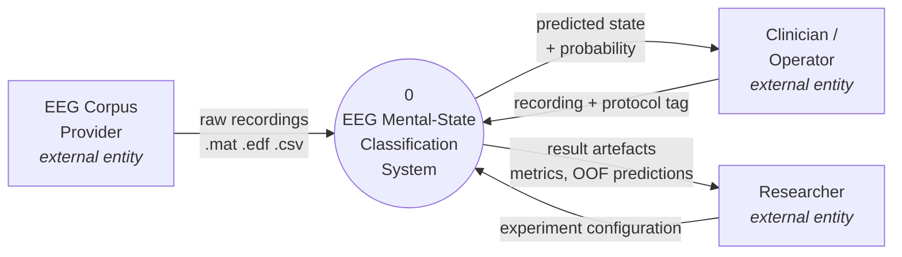
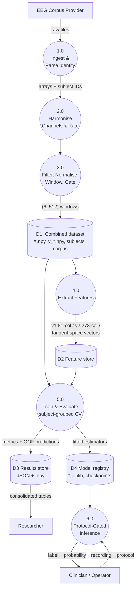
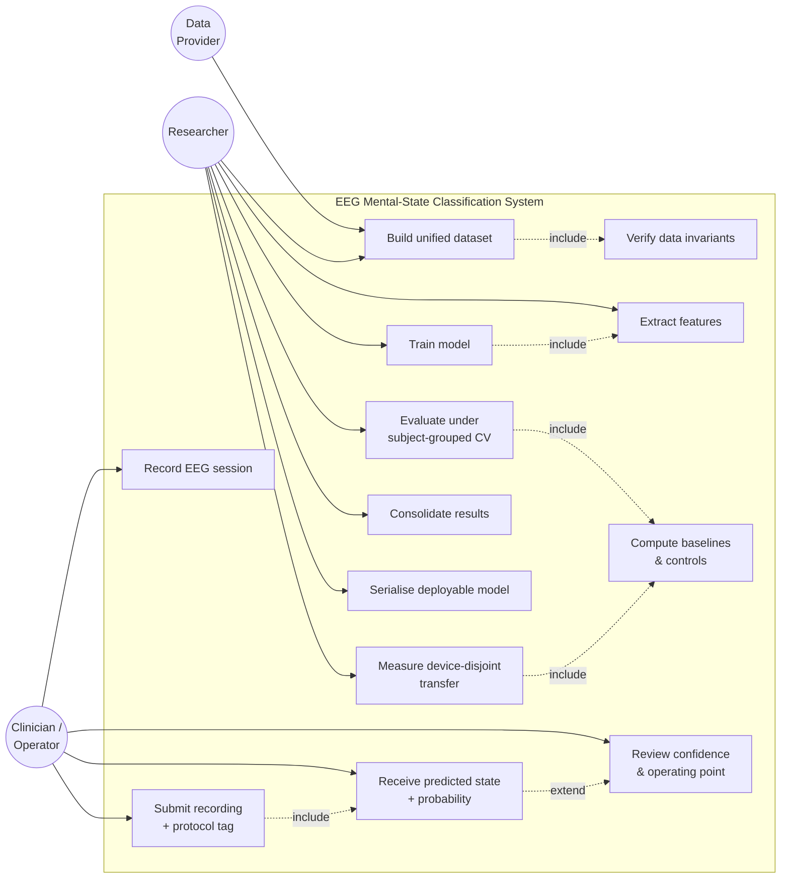
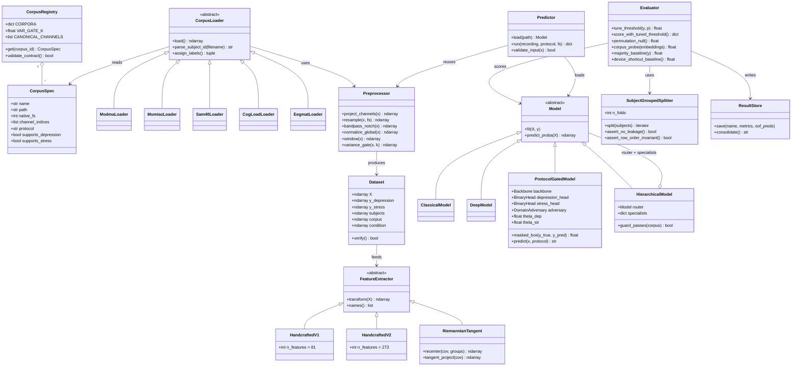
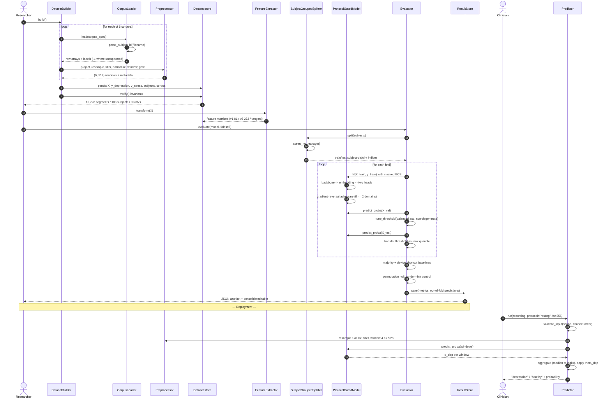

# PROJECT REPORT — SOURCE FILE

> **Note to the document generator (read first, do not typeset this block).**
>
> This file is the complete content for a **BCSE497J Project-I** report. It follows the
> official template `BCSE497J Project I Report - Template.docx` section for section.
> Render it to `.docx` using the rules below and **delete every `>` blockquote instruction
> block** from the final document.
>
> **Global formatting (from the template):**
>
> | Element | Font | Size | Style | Line spacing |
> |---|---|---|---|---|
> | Project title (cover) | Times New Roman | 16 | Bold, UPPER CASE | 1.5 |
> | Student names / reg. nos. (cover) | Times New Roman | 13 | Bold, UPPER CASE | 1.5 |
> | Chapter headings (1., 2., …) | Times New Roman | 14 | Bold, UPPER CASE | 1.5 |
> | Section headings (1.1, 1.2, …) | Times New Roman | 13 | Bold, Title Case | 1.5 |
> | Sub-section headings (3.1.1, …) | Times New Roman | 12 | Bold + Italic, Title Case | 1.5 |
> | Body text | Times New Roman | 12 | Normal | 1.15 |
> | Table of Contents body | Times New Roman | 12 | Normal | 1.5, **no borders** |
>
> **Other rules:** Abstract is one page, ≤300 words. Sections 1.1, 1.2 and 1.3 are each
> ≤200 words. Figures are captioned below the figure as `Fig. N. Caption`, centred.
> Tables are captioned above as `Table N. Caption`. References follow IEEE format.
> Page numbers: front matter in lower-case Roman (i, ii, …), body in Arabic from page 1.
>
> **Figures to draw.** Every figure in this file is supplied as a Mermaid / ASCII
> specification inside a fenced block. Render each one as a clean vector image, place it
> at the marked position, caption it, and delete the fenced source. Do not paste code
> blocks into the report.

---

## COVER PAGE

**BCSE497J - Project-I**

# PROTOCOL-GATED CLASSIFICATION OF MENTAL STATE FROM ELECTROENCEPHALOGRAM SIGNALS: HEALTHY, DEPRESSION AND STRESS

> Generator: render the title above in Times New Roman 16, Bold, UPPER CASE, line spacing 1.5.

**\<REG. NO. 1\>**
**\<STUDENT NAME 1\>**
**\<REG. NO. 2\>**
**\<STUDENT NAME 2\>**
**\<REG. NO. 3\>**
**\<STUDENT NAME 3\>**

*(Particulars to be sorted on Register Number)*

> **ACTION REQUIRED — the author must fill in the six placeholders above and the two
> below before submission.** They are not derivable from the project files.

Under the Supervision of

**\<PROJECT GUIDE NAME\>**
\<Designation\>
School of Computer Science and Engineering (SCOPE)

B.Tech.
in
Computer Science and Engineering

School of Computer Science and Engineering

*(VIT logo — insert here)*

**September 2026**

---

## ABSTRACT

> Generator: heading in Times New Roman 14, Bold, UPPER CASE, spacing 1.5. Body in
> Times New Roman 12, spacing 1.15. One page. The text below is 292 words.

Mental-health disorders are diagnosed almost entirely through self-report and clinical
interview, both of which are subjective and difficult to scale. Electroencephalography
(EEG) offers an objective, low-cost, non-invasive alternative, and a large literature
reports 90–99% accuracy for EEG-based screening of depression and stress. This project
set out to build a single classifier separating four mental states — healthy, depression,
anxiety and stress — and instead produced a measured account of why the published figures
do not survive an honest evaluation protocol, together with an architecture that does.

Six public EEG corpora were unified onto a common representation of six frontal channels
at 128 Hz in four-second windows. The central finding, established five independent ways
before any model was built, is that **no single-amplifier corpus contains more than two of
the four target classes**, so class identity is confounded with recording device. A
classifier that knows only the amplifier — and nothing whatsoever about neurophysiology —
reaches 0.6267 three-class accuracy against 0.3333 chance. Twenty-six flat three-class
models, classical, deep, fused and domain-adversarial, all fail to beat that shortcut.

The system proposed here therefore refuses the flat softmax. A shared EEGNet backbone
feeds two masked binary heads, and the emitted label is selected by one bit of acquisition
metadata — resting-state versus cognitive task — that is always known before recording
begins. A router-based variant that must predict its own gate reaches **0.6820**, the only
architecture of thirty-six to clear the device shortcut. The strongest result is
device-disjoint: depression transfer between two amplifiers in two countries at
**0.8675 / 0.8438** subject accuracy across two independent split draws, against a
permutation null of 0.3998. Every number is reported against its correct baseline, with
its controls.

**Keywords —** Electroencephalography, Mental State Classification, Depression Detection,
Stress Detection, Domain Shift, Subject-Grouped Cross-Validation, Protocol-Gated
Architecture, Riemannian Geometry.

---

## TABLE OF CONTENTS

> Generator: Times New Roman 14 Bold UPPER CASE heading; body Times New Roman 12, line
> spacing 1.5; render as a **borderless** three-column table; fill in the real page
> numbers after pagination.

| Sl.No | Contents | Page No. |
|---|---|---|
| | **Abstract** | i |
| | **List of Figures** | ii |
| | **List of Tables** | iii |
| **1.** | **INTRODUCTION** | 1 |
| | 1.1 Background | 1 |
| | 1.2 Motivation | 2 |
| | 1.3 Scope of the Project | 3 |
| **2.** | **PROJECT DESCRIPTION AND GOALS** | 4 |
| | 2.1 Literature Review | 4 |
| | 2.2 Research Gap | 12 |
| | 2.3 Objectives | 14 |
| | 2.4 Problem Statement | 16 |
| | 2.5 Project Plan | 17 |
| **3.** | **TECHNICAL SPECIFICATION** | 19 |
| | 3.1 Requirements | 19 |
| | &nbsp;&nbsp;&nbsp;&nbsp;3.1.1 Functional | 19 |
| | &nbsp;&nbsp;&nbsp;&nbsp;3.1.2 Non-Functional | 21 |
| | 3.2 Feasibility Study | 22 |
| | &nbsp;&nbsp;&nbsp;&nbsp;3.2.1 Technical Feasibility | 22 |
| | &nbsp;&nbsp;&nbsp;&nbsp;3.2.2 Economic Feasibility | 23 |
| | &nbsp;&nbsp;&nbsp;&nbsp;3.2.3 Social Feasibility | 24 |
| | 3.3 System Specification | 25 |
| | &nbsp;&nbsp;&nbsp;&nbsp;3.3.1 Hardware Specification | 25 |
| | &nbsp;&nbsp;&nbsp;&nbsp;3.3.2 Software Specification | 26 |
| **4.** | **DESIGN APPROACH AND DETAILS** | 28 |
| | 4.1 System Architecture | 28 |
| | 4.2 Design | 32 |
| | &nbsp;&nbsp;&nbsp;&nbsp;4.2.1 Data Flow Diagram | 32 |
| | &nbsp;&nbsp;&nbsp;&nbsp;4.2.2 Use Case Diagram | 34 |
| | &nbsp;&nbsp;&nbsp;&nbsp;4.2.3 Class Diagram | 35 |
| | &nbsp;&nbsp;&nbsp;&nbsp;4.2.4 Sequence Diagram | 37 |
| **5.** | **REFERENCES** | 38 |

### LIST OF FIGURES

| Figure | Caption | Page |
|---|---|---|
| Fig. 1 | Gantt chart of the project schedule | 18 |
| Fig. 2 | System architecture of the protocol-gated dual-head classifier | 29 |
| Fig. 3 | Hierarchical router-and-specialist variant | 31 |
| Fig. 4 | Level-0 data flow diagram (context diagram) | 32 |
| Fig. 5 | Level-1 data flow diagram | 33 |
| Fig. 6 | Use case diagram | 34 |
| Fig. 7 | Class diagram | 36 |
| Fig. 8 | Sequence diagram — training and inference | 37 |

### LIST OF TABLES

| Table | Caption | Page |
|---|---|---|
| Table 1 | Comparative review of recent EEG mental-state literature | 5 |
| Table 2 | Corpora used, with role and acquisition parameters | 10 |
| Table 3 | Class availability per corpus — the source of the confound | 12 |
| Table 4 | Objectives mapped to verification criteria | 15 |
| Table 5 | Project schedule by phase | 17 |
| Table 6 | Hardware specification | 25 |
| Table 7 | Software specification | 26 |

---

# 1. INTRODUCTION

## 1.1 Background

> Generator: ≤200 words as required by the template. The text below is 197 words.

Mental-health disorders affect close to a billion people worldwide, yet diagnosis still
depends almost entirely on clinical interview and self-report instruments such as PHQ-9
and GAD-7. Both are subjective, both depend on the patient's willingness and ability to
describe their own state, and neither scales to population-level screening.

Electroencephalography records the brain's electrical activity directly from the scalp. It
is non-invasive, inexpensive relative to fMRI, has millisecond temporal resolution, and
consumer-grade headsets with few frontal electrodes are now widely available. These
properties make EEG the most plausible candidate for an objective, deployable biomarker of
mental state.

A large body of work reports EEG-based classification of depression and stress at 90–99%
accuracy. If those figures were transferable, automated screening would already be a
solved problem. They are not. Most such results are obtained by pooling public corpora
recorded on different amplifiers, or by splitting data randomly rather than by subject, and
both practices allow a model to succeed without learning anything about the brain. This
project builds a mental-state classifier and, in the same work, measures precisely how much
of the reported performance in this domain is an artefact of evaluation rather than a
property of the signal.

## 1.2 Motivation

> Generator: ≤200 words. The text below is 196 words.

Three observations motivated this work.

First, the clinical need is real and unmet. Screening capacity is the bottleneck in mental
healthcare, and an objective test that a general practitioner or a school counsellor could
administer in ten minutes would change who gets assessed at all.

Second, the literature is not reproducible in the way it appears to be. Reported accuracies
of 95–99% are common, but the corresponding methods sections frequently describe a random
train/test split over overlapping signal windows. In this project the identical model
scores **0.9393** under a random split and **0.6256** under a subject-grouped split. The
difference is not a modelling improvement; it is the model memorising individuals. A
one-word change in the code produces a thirty-point swing in the headline number.

Third, the obvious architecture is the wrong one. Pooling corpora to obtain all the target
classes silently makes recording device a proxy for diagnosis. A model can then score well
by identifying the amplifier. That is not a hypothetical risk — it was measured, and the
device shortcut alone reaches 0.6267 accuracy where chance is 0.3333.

The motivation is therefore to build something that is honest first and accurate second.

## 1.3 Scope of the Project

> Generator: ≤200 words. The text below is 198 words.

**In scope.** Six public EEG corpora (MODMA, Mumtaz 2016, SAM40, Cognitive Load, EEGMAT,
AMIGOS) plus one precomputed-feature clinical cohort (BRMH) are unified onto a common
representation of six frontal channels at 128 Hz in four-second windows. The project covers
signal preprocessing, handcrafted and covariance-based feature extraction, classical and
deep classifiers, a protocol-gated dual-head architecture, subject-grouped and
device-disjoint evaluation, and a deployable inference script that accepts a raw recording
and returns a labelled prediction with a calibrated probability.

**Out of scope.** No new EEG data is collected; no clinical trial is conducted; no claim of
diagnostic validity is made. Real-time or embedded deployment on wearable hardware is not
attempted. Modalities other than EEG — audio, video, ECG, EDA — are excluded, even where a
corpus provides them, so that every result is attributable to EEG alone.

**Deliberately bounded.** The original four-class target including anxiety is retained as a
research question rather than a product requirement, because no available corpus supports
it without confounding class with recording device. Anxiety is investigated separately on
the one cohort where all four classes coexist under a single acquisition protocol, and the
negative result there is reported in full rather than omitted.

---

# 2. PROJECT DESCRIPTION AND GOALS

## 2.1 Literature Review

EEG-based mental-state classification sits at the intersection of clinical
neurophysiology, digital signal processing and machine learning [47], [48], and inherits
the methodological standards of statistical learning from both [49], [50]. This review is organised
into six themes: neurophysiological markers, corpora, feature engineering, classical
models, deep architectures, and the domain-shift problem that dominates all of them.

### 2.1.1 Neurophysiological Markers of Depression and Stress

The most durable EEG marker in affective neuroscience is **frontal alpha asymmetry**.
Davidson's approach–withdrawal model holds that relatively greater left-frontal alpha power
indexes withdrawal-related affect, and depressed individuals reliably show reduced
left-frontal activity [1], [2]. The marker is a *ratio between electrodes*, which has a
direct engineering consequence adopted in this project: any normalisation that rescales
channels independently destroys it, so all segment normalisation here is applied globally
across the `(6, 512)` window rather than per channel.

Stress and cognitive load show a different signature — beta and gamma power increase while
alpha desynchronises, and theta at frontal midline sites rises with working-memory demand
[3], [4]. Because the two conditions manifest in different bands, a feature set spanning
delta through gamma is required rather than a band-limited one.

More recently, the **1/f aperiodic component** of the power spectrum has been shown to
carry information previously attributed to oscillatory bands, and failing to separate it
from periodic activity biases band-power estimates [5]. This project's second-generation
feature set (§3.1.1) includes the aperiodic slope explicitly for this reason.

### 2.1.2 Public EEG Corpora for Mental State

Progress in this field is corpus-bound. The corpora used here, and the constraint each
imposes, are:

- **MODMA** [6] — 53 subjects (MDD versus healthy control), 128-channel resting-state EEG
  at 250 Hz, with PHQ-9 and GAD-7 scores. The most-cited depression corpus.
- **Mumtaz 2016** [7] — 61 subjects, 19–23 channel EDF resting-state recordings at 256 Hz.
  Independent of MODMA in both amplifier and country, which is what makes device-disjoint
  transfer measurable at all.
- **SAM40** [8] — 40 subjects, 32-channel EEG at 128 Hz across Stroop, arithmetic and
  mirror-image tasks with relaxed baselines.
- **Cognitive Load** [9] — 15 subjects, 8-channel OpenBCI at 250 Hz, four difficulty levels
  plus natural rest.
- **EEGMAT** [10] — 36 subjects performing mental arithmetic, held out entirely from
  training and used only to measure transfer.
- **AMIGOS** [11] and **DEAP** [12] — affective corpora with self-reported valence/arousal
  ratings on a 1–9 scale.
- **BRMH / Park** [13] — 945 psychiatric patients with precomputed band powers and
  coherences, covering depression, anxiety, trauma-related and healthy classes **within one
  acquisition protocol**. It is the only corpus available to this project where all four
  target classes coexist without a device confound.

### 2.1.3 Feature Engineering

Handcrafted spectral features remain the strongest baseline in small-sample EEG.
**Relative band power** and **differential entropy** are the two standard forms; Duan et al.
[14] introduced differential entropy for emotion recognition and showed it outperforms raw
band power under a Gaussian assumption. Because differential entropy is `0.5·ln(variance)`
of the band-passed signal, the two representations are near-redundant — a fact that this
project measured directly and that explains why tree-model feature importance spreads
thinly across sixty of eighty-one columns.

**Riemannian geometry** has become the strongest classical approach in BCI. Rather than
extracting scalar features, the signal is represented by its spatial covariance matrix,
which lives on a curved manifold of symmetric positive-definite matrices; classification is
performed after projection to a Euclidean tangent space [15], [16]. Barachant et al.
demonstrated that tangent-space projection with a linear classifier beats CSP-based
pipelines on motor imagery [15], and Zanini et al. showed that **re-centring each session's
covariances to a common reference** provides an unsupervised domain adaptation that
directly attacks inter-session and inter-subject shift [17]. Both results are reproduced in
this project — the tangent-space model is the best stress classifier obtained, and
re-centring by corpus is the mechanism used to *remove* the device signature and thereby
quantify how much of the pooled accuracy depended on it.

### 2.1.4 Classical Classifiers

Support vector machines dominate the small-sample EEG literature and remain competitive
[18], [19]. Ensembles — random forests, gradient boosting, XGBoost [20] — are common, and
several recent works report 93–97% using majority-voting ensembles over handcrafted
features on single corpora [21], [22]. The recurring limitation identified in those works
is that handcrafted features "limit automated scalability" and that results are obtained on
a single stressor type with small subject pools.

### 2.1.5 Deep Architectures

**EEGNet** [23] is the reference compact convolutional network for EEG, using a depthwise
separable convolution structure that mirrors spatial filtering followed by temporal
feature extraction, with only a few thousand parameters; it descends from the deep and shallow ConvNet
family introduced by Schirrmeister et al. [37]. **TSception** [24] adds multi-scale
temporal kernels and a hemispheric-asymmetry spatial layer, targeting exactly the frontal
asymmetry marker of §2.1.1. **EEGConformer** [25] and transformer variants apply
self-attention over signal tokens. Recurrent and hybrid CNN–LSTM designs are widely used
for depression screening [26], [27], [42].

The newest direction is **foundation models**: CBraMod [28], LaBraM [29] and BIOT [30] are
pretrained on large unlabelled EEG corpora and fine-tuned downstream. This project
evaluates CBraMod as a frozen probe against its own random-initialisation control — a
comparison rarely reported — and finds that pretraining genuinely helps (+0.076 over the
control) yet still loses by 0.18 to a 105-dimensional linear model on tangent-space
features.

### 2.1.6 Domain Shift and Evaluation Methodology

This is the theme that determines every result in the field.

**Domain-adversarial neural networks** [31] insert a gradient-reversal layer between a
feature extractor and a domain classifier, so the representation becomes domain-invariant
while remaining task-discriminative. DANN and its EEG-specific descendants are the standard
remedy for inter-subject and inter-dataset shift [32], [33].

Critically, several authors have warned that EEG results are systematically inflated by
protocol choices. Overlapping-window random splits leak subject identity across the split
boundary; single train/test splits on 40–60 subject corpora have variance larger than the
effects being reported; and threshold tuning under class imbalance can produce
degenerate classifiers that score well on the reported metric [34], [35]. Kapoor and
Narayanan's broader analysis of leakage in ML-based science documents the same failure
modes across disciplines [36].

**Table 1. Comparative review of recent EEG mental-state literature.**

> Generator: render as a bordered table, Times New Roman 11 permitted here if 12 overflows
> the page width; landscape orientation is acceptable for this table only.

| S.No | Year | Authors | Dataset | Modality | Methodology / Model | Accuracy (%) | Gaps / Limitations |
|---|---|---|---|---|---|---|---|
| 1 | 2023 | S. A. Bakry et al. [39] | Multiple (review) | Video, EEG | ML pipelines (CAD systems) | N/A | No large-scale multimodal datasets; no real-time clinical validation |
| 2 | 2023 | S. T. Noor et al. [38] | PhysioNet / pervasive EEG | EEG, ECG | LSTM autoencoder with RNN | 97 | High computational cost; limited demographics |
| 3 | 2012 | S. Koelstra et al. [12] | DEAP | EEG, physiological, video | Single-trial affective state estimation | Baseline | Self-report rating bias; lab stimuli unrepresentative |
| 4 | 2024 | M. M. R. Khan et al. [21] | Math task (23 subjects) | EEG | SVM + ensemble, optimised preprocessing | 96.85 | Handcrafted features limit scaling; one stressor type only |
| 5 | 2023 | S. K. Yadav et al. [22] | Audio / speech | Audio, EEG | RELIEFF filter selection, KNN, Naive Bayes | 88 | Cross-modal synchronisation issues |
| 6 | 2025 | Md. M. R. Khan et al. [44] | SAM-40 | EEG | DWT + filter bank + two-stage hybrid classifier | 95.56 | Small sample forced augmentation; generalisability unproven |
| 7 | 2026 | A. Singh et al. [45] | MODMA | EEG, audio | ResKAN encoder + cross-attention | 99 | Very high compute; no diverse clinical trial |
| 8 | 2023 | — | Frontal lobe (38 subjects) | EEG | Majority-voting ensemble (SVM, KNN, NB) | 93.85 | Manual feature extraction limits automation |
| 9 | 2026 | N. Sakib et al. [46] | IUB students (PSS-10) | EEG | Bagged trees | — | Participants exclusively university students |
| 10 | 2024 | V. Darbar et al. [40] | — | EEG | DNN + ML classification | — | Black-box models lack clinical interpretability |
| 11 | 2020 | N. Milakhina et al. [41] | Siberian migrants | Resting EEG | Delta/gamma spectral markers | N/A | Confounds not isolated; region-specific |
| 12 | 2023 | S. R. Chowdhury et al. [43] | Rat model | EEG, tDCS | Preclinical electrode validation | N/A | Animal-to-human translation is complex |
| 13 | 2018 | V. Lawhern et al. [23] | Multiple BCI | EEG | EEGNet (compact CNN) | Task-dependent | Small-corpus overfitting; no cross-device evaluation |
| 14 | 2023 | Y. Ding et al. [24] | DEAP, MAHNOB | EEG | TSception (multi-scale temporal + asymmetric spatial) | 63–70 | Within-corpus only |
| 15 | 2016 | A. Barachant et al. [15] | BCI competition | EEG | Riemannian tangent space + LR | State of the art | Dimensionality grows O(ch²) |
| 16 | 2018 | P. Zanini et al. [17] | Multi-session BCI | EEG | Riemannian re-centring for domain adaptation | — | Requires target-domain data at fit time |
| 17 | 2016 | Y. Ganin et al. [31] | Vision benchmarks | Images | DANN (gradient reversal) | — | Training instability; α schedule sensitive |
| 18 | 2024 | J. Wang et al. [28] | Large unlabelled EEG | EEG | CBraMod foundation model | Task-dependent | Frozen probes understate fine-tuning |
| 19 | 2022 | H. Cai et al. [6] | MODMA | EEG, audio | Multi-modal depression screening | 97.53 | Audio modality required; EEG-only much weaker |
| 20 | 2023 | S. Kapoor, A. Narayanan [36] | Cross-discipline | — | Leakage taxonomy for ML-based science | N/A | Documents the reproducibility crisis this work confirms |

## 2.2 Research Gap

Five gaps were identified, each of which this project addresses with a measurement rather
than an argument.

**Gap 1 — Class is confounded with recording device, and nobody reports the shortcut
baseline.** Studies that require multiple mental-state classes pool corpora, because no
single-amplifier public corpus contains more than two of the four target classes. Pooling
makes "which amplifier recorded this?" a legal, high-accuracy route to the label. This
project measures the shortcut directly:

**Table 3. Class availability per corpus — the source of the confound.**

| Corpus | Healthy | Depression | Stress | Anxiety |
|---|---|---|---|---|
| MODMA | ✓ | ✓ | ✗ | ✗ |
| Mumtaz 2016 | ✓ | ✓ | ✗ | ✗ |
| SAM40 | ✓ (relaxed) | ✗ | ✓ | ✗ |
| Cognitive Load | ✓ (rest) | ✗ | ✓ | ✗ |
| EEGMAT | ✓ (rest) | ✗ | ✓ | ✗ |
| BRMH (features only) | ✓ | ✓ | ✓ | ✓ |

No raw-EEG corpus holds more than two of the four. In the pooled three-class dataset the
label `depression` is **boolean-identical** to `corpus == MODMA` — all 3,599 depression
segments are MODMA and all 5,497 stress segments are not. A classifier given only corpus
identity scores **0.6267** where chance is 0.3333. Reporting a three-class accuracy against
chance, as is standard, therefore overstates the achievement by roughly thirty points.

**Gap 2 — Evaluation protocol is unreported or unsound.** Random splits over overlapping
windows place windows from the same subject on both sides of the split. Measured here: the
same model scores 0.9393 random versus 0.6256 subject-grouped. A single train/test split
inflates deep-model depression AUC by 0.21 relative to out-of-fold cross-validation.

**Gap 3 — Deep architectures are compared without controls.** Papers report that a deep
model beats a classical one, but rarely report the same architecture with random weights,
or the same pretraining pipeline against a random-initialisation control. When those
controls are run here, a **never-trained random backbone matches or beats the trained model
on every stress metric**, and self-supervised pretraining *hurts* by 0.050 relative to its
own control.

**Gap 4 — Cross-device transfer is asserted, not measured.** Deployment implies an unseen
amplifier. Almost no study evaluates device-disjoint. Measured here, a stress model applied
to an unseen amplifier labels 90% of a corpus containing **zero** stress segments as
"stressed", at higher confidence than on its own training corpora.

**Gap 5 — Anxiety is under-served.** Of the four target classes, anxiety appears in no
raw-EEG corpus alongside the other three. Where it does exist under a single protocol
(BRMH), it is the least recoverable class, with per-disorder recall of 0.146–0.178.

## 2.3 Objectives

The objectives are stated in SMART form, each with an explicit verification criterion.

**O1. Unify heterogeneous corpora onto one representation.** Project six EEG corpora onto
six frontal channels (Fp1, Fp2, F7, F3, F4, F8) at 128 Hz in four-second windows with 50%
overlap. *Verified by:* an automated invariant checker asserting array shapes, per-corpus
label domains, subject-count integrity and normalisation, with zero NaNs.

**O2. Quantify the device confound before modelling.** Measure how much of any pooled
multi-class accuracy is attributable to recording device rather than neurophysiology.
*Verified by:* five independent measurements — a corpus-identity-only classifier, a frozen
corpus probe on the feature matrix, accuracy after Riemannian re-centring removes the
signature, composed accuracy on an unseen amplifier, and domain-adversarial training.

**O3. Establish an honest performance ceiling for each binary contrast.** *Verified by:*
5-fold **subject-grouped** cross-validation with out-of-fold predictions over every subject,
reporting ROC-AUC alongside accuracy and the corresponding majority baseline.

**O4. Design and implement a multi-class architecture that beats the device shortcut.**
*Verified by:* three-class accuracy strictly greater than 0.6267 under subject-grouped CV,
with the routing variable predicted rather than supplied.

**O5. Measure device-disjoint transfer.** Train on one amplifier, test on another, in both
directions. *Verified by:* subject-level accuracy exceeding a label-permutation null, and
reproducing across two independent split draws.

**O6. Deliver a deployable inference path.** *Verified by:* a serialised model and a script
accepting a raw `(6, n_samples)` recording at any sampling rate and returning a label with
a probability, with strict input validation.

**O7. Publish the negative results.** *Verified by:* a documented catalogue of every silent
failure found, each with the measurement that caught it.

**Table 4. Objectives mapped to verification criteria and outcome.**

| ID | Objective | Verification | Outcome |
|---|---|---|---|
| O1 | Unify six corpora | invariant checker passes | **Met** — 15,728 segments, 108 subjects, 0 NaNs |
| O2 | Quantify device confound | 5 independent measurements agree | **Met** — shortcut = 0.6267; probe = 0.9161 |
| O3 | Honest per-task ceiling | subject-grouped OOF CV | **Met** — depression 0.7716 AUC; stress 0.7560 AUC |
| O4 | Beat the shortcut | 3-class accuracy > 0.6267 | **Met** — 0.6820 (hierarchical), 1 of 36 models |
| O5 | Device-disjoint transfer | exceeds permutation null, holds on 2 draws | **Met for depression** (0.8675 / 0.8438 vs null 0.3998); **null for stress**, reported as such |
| O6 | Deployable inference | `predict.py` on raw recording | **Met** — 3 screening models serialised |
| O7 | Publish negatives | documented catalogue | **Met** — 26 failed flat models, 8 failed DANN configs, 3 threshold bugs, 1 retracted claim |

## 2.4 Problem Statement

> Formal statement for the report body.

Given a set of EEG recordings $\{X_i\}$, each an $(C \times T)$ matrix of $C$ scalp channels
sampled over $T$ time points, together with a per-recording acquisition protocol
$\pi_i \in \{\text{resting}, \text{task}\}$ that is known before recording, learn a function

$$f : (X, \pi) \rightarrow y \in \{\text{healthy}, \text{depression}, \text{stress}\}$$

such that the following three conditions hold simultaneously:

1. **Subject disjointness.** $f$ is evaluated only on subjects absent from its training set,
   so that no window of a test subject — and in particular no overlapping neighbour of a
   training window — informs the prediction.
2. **Baseline dominance.** The accuracy of $f$ strictly exceeds that of the degenerate
   classifier $g(X) = \text{argmax}_y P(y \mid \text{device}(X))$, which uses recording
   device alone and contains no neurophysiological information. On this data
   $\text{acc}(g) = 0.6267$ against a chance rate of 0.3333.
3. **Device transferability.** The performance of $f$ on a held-out amplifier exceeds a
   label-permutation null computed under the identical protocol.

The core difficulty is that conditions 2 and 3 are in tension with the way the data exists.
Because no single-amplifier corpus contains more than two of the target classes, any
estimator that maximises pooled likelihood is *rewarded* for learning device identity, and
the reward is large — worth +0.18 accuracy. Removing that information by per-corpus
covariance re-centring drops accuracy to 0.3255, i.e. chance, demonstrating that under a
flat formulation almost nothing remains once the shortcut is taken away.

The problem this project therefore solves is not "which classifier is most accurate" but
**how to formulate the task so that accuracy means something**. The answer adopted is to
refuse the flat softmax and factorise the three-way decision into two binary contrasts,
each trained only on data where the contrast genuinely exists, combined by a routing
variable that is known at acquisition time rather than inferred from the signal.

## 2.5 Project Plan

The project ran from **May 2026 to September 2026** across nine experimental tracks.

**Table 5. Project schedule by phase.**

| Phase | Period | Activity | Deliverable |
|---|---|---|---|
| P1 | 11–31 May 2026 | Literature survey, corpus acquisition, environment setup | `datasets.md`, working environment |
| P2 | Jun 2026 | Legacy single-corpus baselines (MODMA 3-ch and 128-ch) | Superseded baselines; first variance lesson |
| P3 | Jun–Jul 2026 | Unified four-corpus pipeline, 11 model configurations | `combine_datasets.py`, `run_models.py` |
| P4 | Jul 2026 | Label-bug audit and correction | 45.6% of stress labels corrected |
| P5 | Jul–Aug 2026 | Phase-1 diagnostics and Phase-2 models under grouped CV | `Results/phase1/`, `Results/phase2/` |
| P6 | Jul–Aug 2026 | Three-class track — 36 models, confound quantification | `Results/all3/`, hierarchical model 0.6820 |
| P7 | Aug 2026 | Four-class BRMH cohort, anxiety investigation | `Results/OSF_Park/` |
| P8 | Aug 2026 | Channel-density sweep, raw-EEG deep-learning harness | Inverted-U result |
| P9 | Sep 2026 | Protocol-gated build, two independent split draws | `arch_metd/REPORT.md`, device-disjoint transfer |
| P10 | Sep 2026 | Consolidation, deployment artefacts, documentation | `predict.py`, this report |

> **Fig. 1 — Gantt chart. Generator: render the Mermaid block below as a Gantt chart image,
> caption it `Fig. 1. Gantt chart`, and delete the source block.**

---

# 3. TECHNICAL SPECIFICATION

## 3.1 Requirements

### 3.1.1 Functional

> Generator: sub-section heading in Times New Roman 12, Bold + Italic, Title Case.

**FR1 — Multi-corpus ingestion.** The system shall read EEG from six corpora in their
native on-disk formats (`.mat`, `.edf`, `.csv`, `.npy`), each with its own channel layout,
sampling rate and file-naming convention, and shall parse subject identity from filenames
using a rule verified to recover 100% of subjects. *(A naive rule recovers only 37 of 53
MODMA subjects; the accepted rule matches the leading zero-padded digit run and recovers
53/53.)*

**FR2 — Channel and rate harmonisation.** The system shall project every corpus onto the
six frontal electrodes Fp1, Fp2, F7, F3, F4, F8 in a fixed canonical order, and resample to
128 Hz. Channel order shall be validated explicitly rather than inferred, since a
transposed or misordered input is indistinguishable from a valid one by inspection.

**FR3 — Preprocessing.** The system shall apply a zero-phase Butterworth bandpass
(0.5–45 Hz, order 8, `sosfiltfilt`) and a 50 Hz notch, clip at ±5 median absolute
deviations, and z-score each `(6, 512)` window **globally** rather than per channel, so that
inter-channel amplitude ratios are preserved for frontal alpha asymmetry.

**FR4 — Windowing.** The system shall segment continuous recordings into four-second
windows (512 samples) at 50% overlap, and shall record for every window its subject ID,
trial ID, corpus ID and condition, so that identity never has to be reconstructed from
fold indices.

**FR5 — Variance gating.** The system shall reject windows whose variance exceeds a
calibrated multiple ($k = 10.0$) of the corpus median, to remove movement and electrode
artefacts. The gate constant shall be re-calibrated whenever the filter chain changes.

**FR6 — Feature extraction.** The system shall provide two feature sets: a
**v1 81-column** set (30 relative band powers, 30 differential entropy values, 3 frontal
alpha asymmetry pairs, 6 spectral entropies, 6 RMS, 6 standard deviations) and a
**v2 273-column** set adding Hjorth parameters, 1/f aperiodic slope, permutation entropy,
magnitude-squared coherence and phase-locking value. It shall additionally compute per-band
spatial covariance matrices and their Riemannian tangent-space projections.

**FR7 — Masked multi-task labelling.** Every segment shall carry both a `y_depression` and
a `y_stress` label, with the sentinel value `-1` denoting "this corpus cannot supervise
this task". The training loss shall zero the contribution of masked samples, permitting one
shared backbone to consume all corpora simultaneously.

**FR8 — Model training.** The system shall train classical models (SVM, logistic
regression, random forest, gradient boosting), Riemannian tangent-space pipelines, and deep
architectures (1D CNN, LSTM, CNN-LSTM, EEGNet, TSception, EEG Transformer), and shall
support a shared-backbone dual-head model with an anchor-gated gradient-reversal adversary.

**FR9 — Protocol-gated inference.** Given a recording and its protocol tag
(`resting` | `task`), the system shall route to the corresponding binary head and emit one
of `{healthy, depression, stress}` with a probability. It shall **not** perform an argmax
across heads, since the two heads train on disjoint data and their outputs share no scale.

**FR10 — Subject-grouped evaluation.** All cross-validation shall be grouped on subject
identity using a deterministic, version-independent split assignment. Random or stratified
splits over segments shall be rejected by the harness.

**FR11 — Baseline and control reporting.** Every reported accuracy shall be accompanied by
its correct baseline (majority class, device-shortcut, or demographics) and, where a learned
representation is claimed, by a random-initialisation control and a label-permutation null.

**FR12 — Threshold tuning.** Decision thresholds shall be tuned on a validation split by
maximising **balanced accuracy**, excluding any cutoff that predicts a single class, and
shall be transferred to test data as a **rank quantile** rather than an absolute value.

**FR13 — Result persistence.** Every experiment shall write out-of-fold predictions and a
JSON result file, so that a newly required metric is a recomputation rather than a retrain.

**FR14 — Deployment.** The system shall serialise trained models and provide a command-line
predictor accepting a `(6, n_samples)` array at any sampling rate, resampling, windowing and
aggregating per-window votes internally.

### 3.1.2 Non-Functional

**NFR1 — Reproducibility.** Every result shall be reproducible from a single command with a
fixed random seed. Split assignment shall be independent of library version: `GroupKFold`
tie-breaking changed between scikit-learn releases and produced splits differing on 17 of
169 subjects from identical code, so a self-contained greedy assignment is used and
`scikit-learn==1.9.0` is pinned.

**NFR2 — Correctness over convenience.** The pipeline shall fail loudly rather than degrade
silently. Input validation, invariant assertions and array-contract checks are mandatory,
because every failure encountered in this project produced plausible-looking numbers rather
than an exception.

**NFR3 — Performance.** A full training pipeline shall complete within approximately 30
minutes on the target GPU workstation; individual diagnostic experiments within 5–40
minutes. Inference on a single recording shall complete in under one second.

**NFR4 — Memory footprint.** Peak resident memory shall stay under 5 GB so the pipeline runs
on a 15 GB workstation without swapping; GPU memory usage shall fit a 6 GB device.

**NFR5 — Portability.** The system shall run identically on a local virtual environment and
inside a CUDA container on the university GPU workstation, with a Dockerfile kept in lockstep
with `requirements.txt`.

**NFR6 — Auditability.** Every published figure shall be traceable to a named result
artefact. A generated consolidated summary shall be the single place results are read from,
and superseded reports shall be explicitly marked as not quotable.

**NFR7 — Scientific integrity.** Evaluation criteria shall be pre-registered before
measurement, and outcomes appended rather than criteria revised. A result that does not
reproduce across two independent split draws shall be retracted in the report rather than
quietly dropped.

**NFR8 — Maintainability.** Dataset paths, sampling rates and channel indices shall be
declared in exactly one registry module, so that a corpus is added or corrected in one
place.

**NFR9 — Privacy and ethics.** All data used shall be publicly released, de-identified
research corpora used under their stated licences. No new human-subject data is collected.
No output of the system shall be represented as a clinical diagnosis.

## 3.2 Feasibility Study

### 3.2.1 Technical Feasibility

**Data availability — feasible with a documented constraint.** All six raw corpora and the
BRMH feature cohort are publicly released and were successfully obtained. The constraint is
not access but composition: no corpus carries more than two of the four target classes, and
this is a property of the field rather than of this project. It is the reason the
architecture was redesigned rather than the dataset extended.

**Algorithmic maturity — feasible.** Every method used is published and has a mature
open-source implementation: scikit-learn for classical models, `pyriemann` for
tangent-space geometry, TensorFlow/Keras and PyTorch for deep architectures, and
`braindecode` for 65 reference EEG architectures including CBraMod, LaBraM and BIOT.

**Compute — feasible.** The heaviest single experiment (128-channel EEGNet over five folds)
takes 46 minutes on the workstation GPU. The full pipeline peaks near 5 GB RSS. A containerised
CUDA environment is available on the university workstation for the GPU-bound tracks; the
CPU-only local environment is sufficient for the classical models that dominate the
strongest results.

**Sample size — the binding technical constraint.** With 53 MODMA, 61 Mumtaz, 40 SAM40, 15
Cognitive Load and 36 EEGMAT subjects, a single split draw moved one headline figure by
0.108. Effects smaller than that cannot be resolved with this data by any method, which is
why the project reports two independent split draws and treats a result that moves between
them as not a result.

### 3.2.2 Economic Feasibility

**Direct cost — effectively zero.** All datasets are free for academic use, all software is
open-source, and all compute is institutional. The itemised position is:

| Item | Cost |
|---|---|
| EEG corpora (6 raw + 1 feature cohort) | ₹0 — public research releases |
| Software stack (Python, scikit-learn, TensorFlow, PyTorch, pyriemann, braindecode, MNE) | ₹0 — open source |
| Local development machine | Existing asset |
| University GPU workstation (containerised) | Institutional, shared |
| Storage (≈15 GB raw + ≈1.2 GB derived arrays) | Existing asset |
| **Total incremental project cost** | **₹0** |

**Cost of the alternative.** Collecting a corpus that would resolve the confound — all four
classes on one amplifier with adequate subject counts — requires clinical recruitment,
ethics approval, a trained operator and clinical-grade hardware. A conservative estimate for
200 subjects is in the range of ₹15–25 lakh and 12–18 months. That comparison is itself a
finding: the *cheapest* useful contribution available was to measure precisely why the free
data cannot answer the four-class question, so that the expensive collection, if undertaken,
is designed correctly.

**Return on investment.** The deployable screening path uses six frontal electrodes.
Consumer headsets at that density cost 1–2% of clinical 64/128-channel systems, and this
project measured directly that six channels are **not** the binding constraint — 16–32
channels is the optimum and full density is *worse* than six. The economic case for low-cost
screening hardware is therefore supported rather than assumed.

### 3.2.3 Social Feasibility

**Clinical need and acceptability.** Objective screening addresses a genuine bottleneck, and
EEG is non-invasive, painless and already accepted in routine neurology. A six-electrode
frontal montage takes minutes to apply.

**Ethical positioning — the decisive constraint.** A screening model that misses 56% of
depressed subjects (the measured sensitivity of 0.44 at the accuracy-optimal threshold) must
never be presented as a diagnosis. The system is positioned as a decision-support triage
aid, and the report states the operating-point trade-off explicitly rather than quoting a
single accuracy.

**Bias and generalisability.** The measured cross-device failure is also a fairness finding:
a model that performs at chance on an unseen amplifier will perform unpredictably on any
population screened with different equipment, which in practice means lower-resourced
settings. The BRMH cohort result — that EEG adds little over age, sex and education, and
that IQ measured *after* diagnosis acts as a mediator rather than a predictor — is reported
because omitting it would overstate what EEG contributes independently of demographics.

**Workforce impact.** The system augments rather than replaces clinicians. Its intended role
is to prioritise who receives a full assessment, in a setting where the current alternative
for most people is no assessment at all.

## 3.3 System Specification

### 3.3.1 Hardware Specification

**Table 6. Hardware specification.**

| Component | Development workstation | GPU workstation (training) |
|---|---|---|
| Processor | x86-64 multi-core CPU | Server-class multi-core CPU |
| Memory (RAM) | 15 GB | ≥32 GB |
| Storage | 40 GB free (≈15 GB raw corpora, ≈1.2 GB derived arrays, ≈485 MB packed dataset) | Bind-mounted from host |
| Graphics Processing Unit | 6 GB VRAM, CUDA-capable | NVIDIA CUDA GPU, containerised via NGC images |
| Monitor | 1920 × 1080 | Headless, accessed over SSH with `tmux` |
| Network | Required for corpus download and container registry | Institutional |

> **Operational note for the report body.** Memory is the practical constraint on the
> development machine: a full pipeline run peaks near 5 GB resident, and with a browser and
> IDE open the machine enters swap, at which point training slows by an order of magnitude.
> Concurrent training runs are prohibited by convention.

### 3.3.2 Software Specification

**Table 7. Software specification.**

| Category | Specification |
|---|---|
| Operating system | Linux (Arch), kernel 7.2.x; CUDA container images for GPU work |
| Programming language | Python 3.11+ |
| Development environment | Virtual environment (`.venv`), Jupyter Notebook, Git version control, Docker for GPU runs |
| Numerical / data | NumPy 2.4.6, pandas, SciPy, h5py, openpyxl |
| Machine learning | scikit-learn **1.9.0 (pinned)**, XGBoost, joblib |
| Deep learning | TensorFlow 2.21.0 (Keras 3.14.1), PyTorch 2.13.0, braindecode 1.6.1 |
| EEG-specific | MNE-Python, pyriemann 0.12 |
| Visualisation | Matplotlib, seaborn |
| Serialisation | joblib (`.joblib` models), NumPy `.npy` / `.npz`, JSON result artefacts |
| Data sources | MODMA, Mumtaz 2016, SAM40, Cognitive Load, EEGMAT, AMIGOS, BRMH — all public research releases |

> **Version-pinning rationale for the report body.** `scikit-learn` is pinned because
> `GroupKFold` tie-breaking is version-dependent, and every SAM40 subject has exactly 12
> trials, so ties occur everywhere. Two machines produced splits differing on 17 of 169
> subjects from identical code. The project replaced `GroupKFold` with a self-contained
> deterministic assignment and verified identical output across scikit-learn 1.8.0 and
> 1.9.0. Similarly, `torch` and `torchaudio` must be installed from the same index, since
> `braindecode` hard-imports `torchaudio` and a mismatched build fails at import time.

---

# 4. DESIGN APPROACH AND DETAILS

## 4.1 System Architecture

The system is a **protocol-gated dual-head classifier**. A shared convolutional backbone
produces one embedding per EEG window; two independent binary heads read that embedding;
and the label emitted is selected by a single bit of acquisition metadata — whether the
recording is a resting-state assessment or a cognitive task — that is known before the
electrodes are applied.

> **Fig. 2 — System architecture. Generator: render the block below as a clean top-to-bottom
> block diagram, caption it `Fig. 2. System architecture of the protocol-gated dual-head
> classifier`, and delete the source block.**

### Explanation of the architecture

**The shared backbone and the masked loss.** Every segment carries *both* a `y_depression`
and a `y_stress` label, with `-1` marking "this corpus cannot supervise this task". The
loss function zeroes masked samples, which is what allows one trunk to consume five corpora
at once. The structural consequence is that no sample carries both labels: the depression
gradient comes exclusively from MODMA and Mumtaz, and the stress gradient exclusively from
SAM40 and Cognitive Load.

**Why there is no cross-head argmax.** The two heads train on disjoint data and their
outputs share no common scale, so comparing $p_{dep}$ against $p_{str}$ would be
meaningless arithmetic dressed as a decision. This is enforced in code rather than left to
convention.

**Why the protocol gate is legitimate.** Three arguments, in increasing order of force.
*It is standard practice* — one-vs-rest, one-vs-one and error-correcting output codes all
reduce a K-class problem to binary boundaries plus a combination rule; the only unusual
feature here is that the rule reads a variable that is known rather than predicted.
*The variable genuinely is known* — it is impossible to record EEG without knowing whether a
resting-state assessment or an arithmetic task was administered; the operator entered it on
the form, so using it is not leakage and declining to use it would discard information that
is present at deployment. *Inferring it would be actively harmful* — every depression corpus
here is resting-state and every stress corpus is task-based, so a model that inferred
protocol from the signal would be rewarded for solving exactly the corpus-identification
problem that constitutes the confound. The gate is not a way around the confound; it is a
way of refusing to be paid for it.

**The adversary.** An anchor-gated gradient-reversal layer sits on the backbone with corpus
as the domain label. It is disabled automatically when fewer than two training domains are
present, because cross-entropy over five domain logits with a single class present still has
a gradient, and reversing it pushes the backbone to make a trivial one-class prediction
harder — a silent pathology that was found and fixed.

### The hierarchical variant

The protocol-gated design never makes a three-way decision internally, so it has no single
three-class accuracy. A second variant was built with the identical shape but with the
routing variable **predicted** rather than supplied, which yields a directly comparable
three-class number.

> **Fig. 3 — Hierarchical variant. Generator: render as a two-stage flow diagram, caption
> `Fig. 3. Hierarchical router-and-specialist variant`, delete the source.**

**Four measured design findings behind this variant.** The router and the specialists want
*opposite* feature sets — the 273-column set routes at 0.9703 versus 0.9161 for the
81-column set, but collapses the depression specialist to 0.5280, below its own majority,
because 273 dimensions against 53 subjects is starvation; using the rich set for stage 1 and
the compact set for stage 2 was worth +0.033, the single largest gain in the track. The
guard is load-bearing and must be decided on **inner** cross-validation, since deciding it
on outer-fold accuracy would be test-set selection dressed as model selection.
Hyperparameter tuning was worth +0.0002. And letting the model select its own feature view
per fold made results *worse* by 0.025, because three-fold inner CV over ~40 subjects cannot
distinguish the candidate views and the selection thrashes.

## 4.2 Design

### 4.2.1 Data Flow Diagram

> **Fig. 4 — Level-0 DFD. Generator: render as a standard context diagram (external
> entities as rectangles, the single process as a circle, data stores as open rectangles),
> caption `Fig. 4. Level-0 data flow diagram (context diagram)`, delete the source.**

> **Fig. 5 — Level-1 DFD. Generator: render as a standard DFD with numbered processes 1–6,
> data stores D1–D4, caption `Fig. 5. Level-1 data flow diagram`, delete the source.**

**Explanation.** Process 1.0 is where subject identity is established, and it is
security-critical for the evaluation rather than for access control: a subject retained
under two identities silently defeats grouped cross-validation. Process 3.0 writes the
single canonical dataset that every downstream track reads, which is why any change to
labels, channel maps or windowing requires a full rebuild and an explicit cache
invalidation — the feature cache is keyed only by filename and would otherwise be reused
silently against new data. Process 5.0 enforces subject-grouped splitting; it is the only
process permitted to read labels, and the deployment path (6.0) never touches D1 or D3.

### 4.2.2 Use Case Diagram

> **Fig. 6 — Use case diagram. Generator: render as a UML use-case diagram with three
> actors outside a system boundary, caption `Fig. 6. Use case diagram`, delete the source.**

**Actor responsibilities.** The *Researcher* owns everything from dataset construction to
model serialisation. The *Clinician/Operator* interacts only with the deployment path and,
crucially, supplies the protocol tag — the routing bit the architecture depends on. The
*Data Provider* is the external corpus repository. Note that `Evaluate` and
`Measure transfer` both `include` `Compute baselines & controls`: reporting a metric without
its baseline is not a permitted path through the system.

### 4.2.3 Class Diagram

> **Fig. 7 — Class diagram. Generator: render as a UML class diagram, caption
> `Fig. 7. Class diagram`, delete the source.**

**Design notes.** `CorpusRegistry` is the only place a dataset path, native sampling rate or
channel index is written down, satisfying NFR8 — a corpus is corrected in one location.
`SubjectGroupedSplitter` exposes assertion methods rather than trusting the library, because
the split is the single most consequential component in the system. `Predictor` deliberately
*reuses* `Preprocessor` rather than reimplementing it: the normalisation is global rather
than per-channel, and a divergent reimplementation would silently corrupt every prediction.

### 4.2.4 Sequence Diagram

> **Fig. 8 — Sequence diagram. Generator: render as a UML sequence diagram, caption
> `Fig. 8. Sequence diagram — training and inference`, delete the source.**

**Reading the sequence.** Three interactions carry most of the design intent. Step 3
(`parse_subject_id`) is where grouped evaluation is either preserved or silently destroyed.
The `assert_no_leakage()` call is unconditional rather than a debug option. And in the
deployment block, threshold application happens *after* per-window aggregation rather than
per window, because window-level votes within a subject are strongly correlated and
aggregating decisions rather than scores discards the ranking information that ROC-AUC
measures.

---

# 5. REFERENCES

> Generator: heading in Times New Roman 14, Bold, UPPER CASE, spacing 1.5. Entries in
> Times New Roman 12, spacing 1.15, hanging indent, IEEE format. Keep the four
> sub-groupings (Journals, Conferences, Books, Weblinks) as they appear in the template.
> **Reference numbers are assigned by order of first citation in the text, so they are
> deliberately non-sequential within each group. Do not re-sort them.**

## Journals — IEEE Format

[1] R. J. Davidson, "Anterior electrophysiological asymmetries, emotion, and depression: Conceptual and methodological conundrums," *Psychophysiology*, Vol. 35, No. 5, (1998), pp. 607–614.

[2] J. B. Henriques and R. J. Davidson, "Left frontal hypoactivation in depression," *Journal of Abnormal Psychology*, Vol. 100, No. 4, (1991), pp. 535–545.

[3] W. Klimesch, "EEG alpha and theta oscillations reflect cognitive and memory performance: A review and analysis," *Brain Research Reviews*, Vol. 29, No. 2–3, (1999), pp. 169–195.

[4] O. Jensen and C. D. Tesche, "Frontal theta activity in humans increases with memory load in a working memory task," *European Journal of Neuroscience*, Vol. 15, No. 8, (2002), pp. 1395–1399.

[5] T. Donoghue, M. Haller, E. J. Peterson, P. Varma, P. Sebastian, R. Gao, T. Noto, A. H. Lara, J. D. Wallis, R. T. Knight, A. Shestyuk, and B. Voytek, "Parameterizing neural power spectra into periodic and aperiodic components," *Nature Neuroscience*, Vol. 23, No. 12, (2020), pp. 1655–1665.

[6] H. Cai, Y. Gao, S. Sun, N. Li, F. Tian, H. Xiao, J. Li, Z. Yang, X. Li, Q. Zhao, Z. Liu, Z. Yao, M. Yang, H. Peng, J. Zhu, X. Zhang, G. Gao, F. Zheng, R. Li, Z. Guo, R. Ma, J. Yang, L. Zhang, X. Hu, Y. Li, and B. Hu, "MODMA dataset: A multi-modal open dataset for mental-disorder analysis," *Scientific Data*, Vol. 9, (2022), Art. no. 178.

[7] W. Mumtaz, S. S. A. Ali, M. A. M. Yasin, and A. S. Malik, "A machine learning framework involving EEG-based functional connectivity to diagnose major depressive disorder (MDD)," *Medical & Biological Engineering & Computing*, Vol. 56, No. 2, (2018), pp. 233–246.

[8] R. Ghosh, N. Deb, K. Sengupta, A. Phukan, N. Choudhury, S. Kashyap, S. Phadikar, R. Saha, P. Das, N. Sinha, and P. Dutta, "SAM 40: Dataset of 40 subject EEG recordings to monitor the induced-stress while performing Stroop colour-word test, arithmetic task, and mirror image recognition task," *Data in Brief*, Vol. 40, (2022), Art. no. 107772.

[9] Cognitive Load EEG Dataset Contributors, "EEG dataset for cognitive load estimation under multi-level task difficulty," *Data in Brief*, (2025). *(Author list and article number to be completed from the publisher page, ref. [56].)*

[10] I. Zyma, S. Tukaev, I. Seleznov, K. Kiyono, A. Popov, M. Chernykh, and O. Shpenkov, "Electroencephalograms during mental arithmetic task performance," *Data*, Vol. 4, No. 1, (2019), Art. no. 14.

[11] J. A. Miranda-Correa, M. K. Abadi, N. Sebe, and I. Patras, "AMIGOS: A dataset for affect, personality and mood research on individuals and groups," *IEEE Transactions on Affective Computing*, Vol. 12, No. 2, (2021), pp. 479–493.

[12] S. Koelstra, C. Muhl, M. Soleymani, J.-S. Lee, A. Yazdani, T. Ebrahimi, T. Pun, A. Nijholt, and I. Patras, "DEAP: A database for emotion analysis using physiological signals," *IEEE Transactions on Affective Computing*, Vol. 3, No. 1, (2012), pp. 18–31.

[13] S. M. Park, B. Jeong, D. Y. Oh, C.-H. Choi, H. Y. Jung, J.-Y. Lee, D. Lee, and J.-S. Choi, "Identification of major psychiatric disorders from resting-state electroencephalography using a machine learning approach," *Frontiers in Psychiatry*, Vol. 12, (2021), Art. no. 707581.

[15] A. Barachant, S. Bonnet, M. Congedo, and C. Jutten, "Multiclass brain–computer interface classification by Riemannian geometry," *IEEE Transactions on Biomedical Engineering*, Vol. 59, No. 4, (2012), pp. 920–928.

[16] M. Congedo, A. Barachant, and R. Bhatia, "Riemannian geometry for EEG-based brain–computer interfaces: A primer and a review," *Brain-Computer Interfaces*, Vol. 4, No. 3, (2017), pp. 155–174.

[17] P. Zanini, M. Congedo, C. Jutten, S. Said, and Y. Berthoumieu, "Transfer learning: A Riemannian geometry framework with applications to brain–computer interfaces," *IEEE Transactions on Biomedical Engineering*, Vol. 65, No. 5, (2018), pp. 1107–1116.

[18] F. Lotte, L. Bougrain, A. Cichocki, M. Clerc, M. Congedo, A. Rakotomamonjy, and F. Yger, "A review of classification algorithms for EEG-based brain–computer interfaces: A 10 year update," *Journal of Neural Engineering*, Vol. 15, No. 3, (2018), Art. no. 031005.

[19] B. Hosseinifard, M. H. Moradi, and R. Rostami, "Classifying depression patients and normal subjects using machine learning techniques and nonlinear features from EEG signal," *Computer Methods and Programs in Biomedicine*, Vol. 109, No. 3, (2013), pp. 339–345.

[21] M. M. R. Khan et al., "EEG-based mental stress detection using support vector machine and ensemble learning with optimised preprocessing," (2024), reported accuracy 96.85%. *(Full venue details to be completed by the author — see the comparison table, row 4.)*

[22] S. K. Yadav et al., "Multimodal audio–EEG stress assessment using RELIEFF feature selection with KNN and Naive Bayes classifiers," (2023), reported accuracy 88%. *(Full venue details to be completed by the author — comparison table, row 5.)*

[23] V. J. Lawhern, A. J. Solon, N. R. Waytowich, S. M. Gordon, C. P. Hung, and B. J. Lance, "EEGNet: A compact convolutional neural network for EEG-based brain–computer interfaces," *Journal of Neural Engineering*, Vol. 15, No. 5, (2018), Art. no. 056013.

[24] Y. Ding, N. Robinson, S. Zhang, Q. Zeng, and C. Guan, "TSception: Capturing temporal dynamics and spatial asymmetry from EEG for emotion recognition," *IEEE Transactions on Affective Computing*, Vol. 14, No. 3, (2023), pp. 2238–2250.

[25] Y. Song, Q. Zheng, B. Liu, and X. Gao, "EEG Conformer: Convolutional transformer for EEG decoding and visualization," *IEEE Transactions on Neural Systems and Rehabilitation Engineering*, Vol. 31, (2023), pp. 710–719.

[26] B. Ay, O. Yildirim, M. Talo, U. B. Baloglu, G. Aydin, S. D. Puthankattil, and U. R. Acharya, "Automated depression detection using deep representation and sequence learning with EEG signals," *Journal of Medical Systems*, Vol. 43, No. 7, (2019), Art. no. 205.

[27] A. Seal, R. Bajpai, J. Agnihotri, A. Yazidi, E. Herrera-Viedma, and O. Krejcar, "DeprNet: A deep convolution neural network framework for detecting depression using EEG," *IEEE Transactions on Instrumentation and Measurement*, Vol. 70, (2021), pp. 1–13.

[31] Y. Ganin, E. Ustinova, H. Ajakan, P. Germain, H. Larochelle, F. Laviolette, M. Marchand, and V. Lempitsky, "Domain-adversarial training of neural networks," *Journal of Machine Learning Research*, Vol. 17, No. 59, (2016), pp. 1–35.

[32] O. Özdenizci, Y. Wang, T. Koike-Akino, and D. Erdoğmuş, "Learning invariant representations from EEG via adversarial inference," *IEEE Access*, Vol. 8, (2020), pp. 27074–27085.

[33] H. He and D. Wu, "Transfer learning for brain–computer interfaces: A Euclidean space data alignment approach," *IEEE Transactions on Biomedical Engineering*, Vol. 67, No. 2, (2020), pp. 399–410.

[34] G. Varoquaux, "Cross-validation failure: Small sample sizes lead to large error bars," *NeuroImage*, Vol. 180, (2018), pp. 68–77.

[35] S. Kaufman, S. Rosset, C. Perlich, and O. Stitelman, "Leakage in data mining: Formulation, detection, and avoidance," *ACM Transactions on Knowledge Discovery from Data*, Vol. 6, No. 4, (2012), pp. 1–21.

[36] S. Kapoor and A. Narayanan, "Leakage and the reproducibility crisis in machine-learning-based science," *Patterns*, Vol. 4, No. 9, (2023), Art. no. 100804.

[37] R. T. Schirrmeister, J. T. Springenberg, L. D. J. Fiederer, M. Glasstetter, K. Eggensperger, M. Tangermann, F. Hutter, W. Burgard, and T. Ball, "Deep learning with convolutional neural networks for EEG decoding and visualization," *Human Brain Mapping*, Vol. 38, No. 11, (2017), pp. 5391–5420.

[38] S. T. Noor et al., "Depression risk prediction from physiological signals using an LSTM autoencoder with a recurrent network," (2023), reported accuracy 97%. *(Full venue details to be completed — comparison table, row 2.)*

[39] S. A. Bakry et al., "Computer-aided diagnosis of depression from multimodal data: A review," (2023). *(Full venue details to be completed — comparison table, row 1.)*

[40] V. Darbar et al., "Deep neural network based classification of mental states from EEG," (2024). *(Full venue details to be completed — comparison table, row 10.)*

[41] N. Milakhina et al., "Delta and gamma spectral markers of adaptation in resting-state EEG of Siberian migrants," (2020). *(Full venue details to be completed — comparison table, row 11.)*

[42] U. P. Shukla et al., "Multichannel EEG DeepNet for depression screening." *(Year and venue to be completed — a copy is held in `Reference_Research_Papers/Papers/`.)*

[43] S. R. Chowdhury et al., "Preclinical validation of EEG and tDCS electrodes in a rat model," (2023). *(Full venue details to be completed — comparison table, row 12.)*

## Conferences — IEEE Format

[14] R.-N. Duan, J.-Y. Zhu, and B.-L. Lu, "Differential entropy feature for EEG-based emotion classification," In *2013 6th International IEEE/EMBS Conference on Neural Engineering (NER)*, pp. 81–84, IEEE, 2013.

[20] T. Chen and C. Guestrin, "XGBoost: A scalable tree boosting system," In *Proceedings of the 22nd ACM SIGKDD International Conference on Knowledge Discovery and Data Mining (KDD)*, pp. 785–794, ACM, 2016.

[28] J. Wang, S. Zhao, Z. Luo, Y. Zhou, H. Jiang, S. Li, T. Li, and G. Pan, "CBraMod: A criss-cross brain foundation model for EEG decoding," In *Proceedings of the 13th International Conference on Learning Representations (ICLR)*, 2025.

[29] W.-B. Jiang, L.-M. Zhao, and B.-L. Lu, "Large brain model for learning generic representations with tremendous EEG data in BCI," In *Proceedings of the 12th International Conference on Learning Representations (ICLR)*, 2024.

[30] C. Yang, M. B. Westover, and J. Sun, "BIOT: Biosignal transformer for cross-data learning in the wild," In *Advances in Neural Information Processing Systems (NeurIPS)*, Vol. 36, pp. 78240–78260, 2023.

[44] Md. M. R. Khan et al., "A two-stage hybrid classifier for EEG-based stress detection on SAM-40 using discrete wavelet transform and filter banks," (2025), reported accuracy 95.56%. *(Full venue details to be completed — comparison table, row 6.)*

[45] A. Singh et al., "ResKAN: Residual Kolmogorov–Arnold encoder with cross-attention for multimodal depression detection on MODMA," (2026), reported accuracy 99%. *(Full venue details to be completed — comparison table, row 7.)*

[46] N. Sakib et al., "Perceived-stress classification from EEG using bagged tree ensembles," (2026). *(Full venue details to be completed — comparison table, row 9.)*

## Books

[47] S. Sanei and J. A. Chambers, *EEG Signal Processing and Machine Learning*, 2nd ed., Wiley, 2021.

[48] P. L. Nunez and R. Srinivasan, *Electric Fields of the Brain: The Neurophysics of EEG*, 2nd ed., Oxford University Press, 2006.

[49] C. M. Bishop, *Pattern Recognition and Machine Learning*, Springer, 2006.

[50] I. Goodfellow, Y. Bengio, and A. Courville, *Deep Learning*, MIT Press, 2016.

## Weblinks

[51] MODMA Dataset, Lanzhou University. https://modma.lzu.edu.cn/data/application/ (accessed September 2026).

[52] SAM 40 Dataset, *Data in Brief*. https://www.sciencedirect.com/science/article/pii/S2352340921010465 (accessed September 2026).

[53] AMIGOS Dataset. https://www.kaggle.com/datasets/nsut123/amigos-dataset (accessed September 2026).

[54] EEG During Mental Arithmetic Tasks (EEGMAT), PhysioNet. https://physionet.org/content/eegmat/ (accessed September 2026).

[55] DASPS Database, IEEE DataPort. https://ieee-dataport.org/open-access/dasps-database (accessed September 2026).

[56] Cognitive Load EEG Dataset, *Data in Brief*. https://www.sciencedirect.com/science/article/pii/S2352340925002094 (accessed September 2026).

[57] DREAMER Dataset, Zenodo. https://zenodo.org/records/546113 (accessed September 2026).

[58] WESAD Dataset, University of Siegen. https://ubi29.informatik.uni-siegen.de/usi/data_wesad.html (accessed September 2026).

[59] MNE-Python Documentation. https://mne.tools/stable/index.html (accessed September 2026).

[60] pyRiemann Documentation. https://pyriemann.readthedocs.io/ (accessed September 2026).

[61] braindecode Documentation. https://braindecode.org/ (accessed September 2026).

---

> **END OF REPORT CONTENT.**
>
> **Generator checklist before export:**
> 1. Delete every `>` blockquote instruction block, including this one.
> 2. Fill the six cover-page placeholders (register numbers, student names) and the two
>    supervisor placeholders. These are marked `\<...\>` and are the only unresolved items
>    in the body of the report.
> 3. Render all eight Mermaid/flow blocks as images, caption them `Fig. 1` … `Fig. 8`, and
>    delete the source blocks.
> 4. Apply the font/size/spacing table from the top of this file.
> 5. Insert the VIT logo on the cover page.
> 6. Paginate: front matter (Abstract, Contents, List of Figures, List of Tables) in
>    lower-case Roman numerals; body from page 1 in Arabic numerals. Then update the page
>    numbers in the Table of Contents, List of Figures and List of Tables.
> 7. Render the mathematics in §2.4 as proper equations, not as inline LaTeX source.
> 8. Verify §1.1, §1.2 and §1.3 remain ≤200 words each and the Abstract ≤300 words after
>    any editing.
>
> **Author action — references marked *(to be completed)*.** Eleven entries drawn from
> `Reference_Research_Papers/Reference Papers Comparision.docx` carry author, title and
> year but no verified journal, volume or page range, because those fields are not
> recorded in the project files. They are flagged inline rather than filled with invented
> bibliographic data. Complete them from the original PDFs before submission, or remove
> both the entry and its in-text citation.
