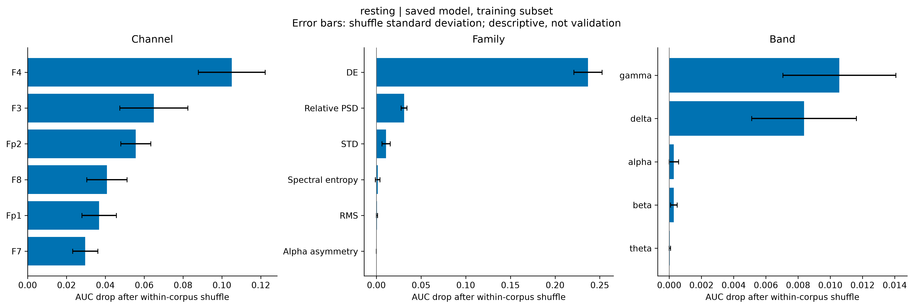
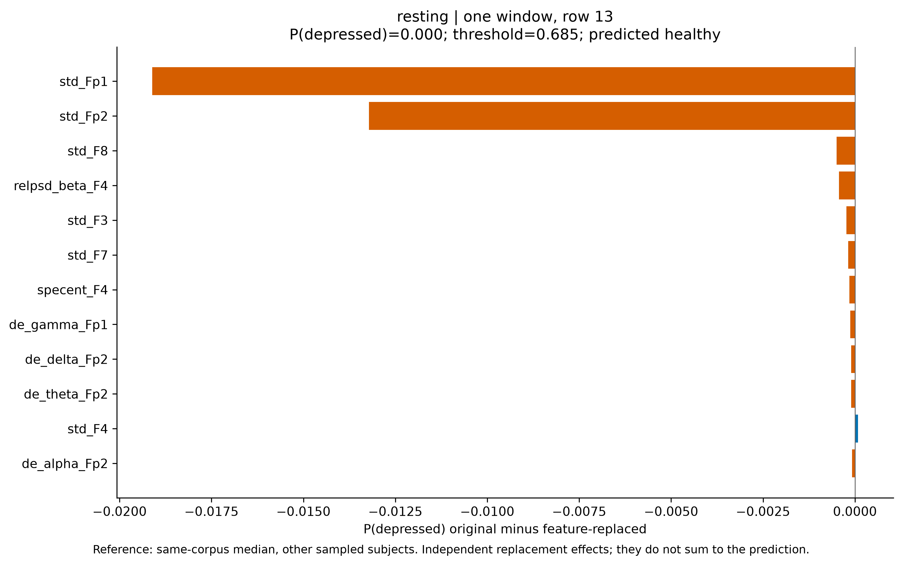
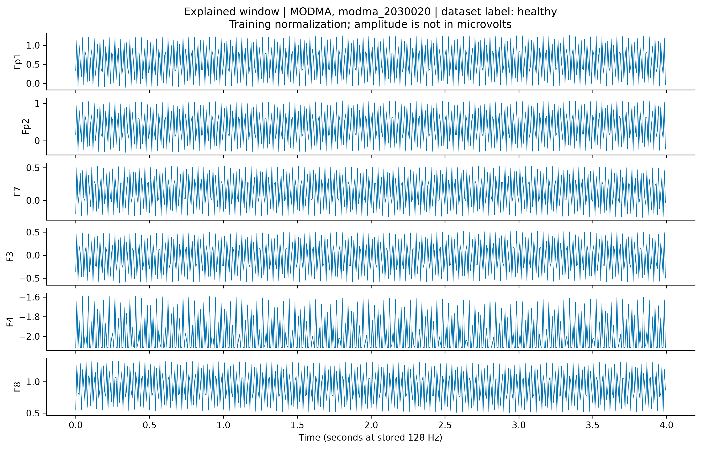
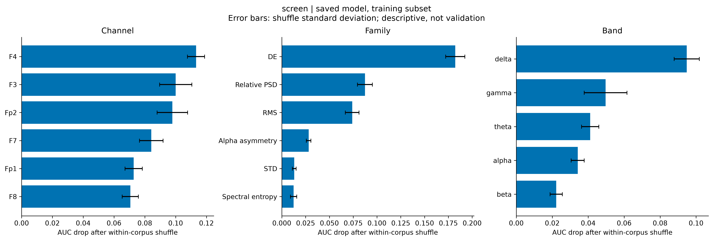
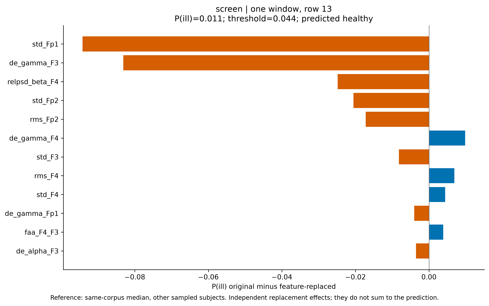
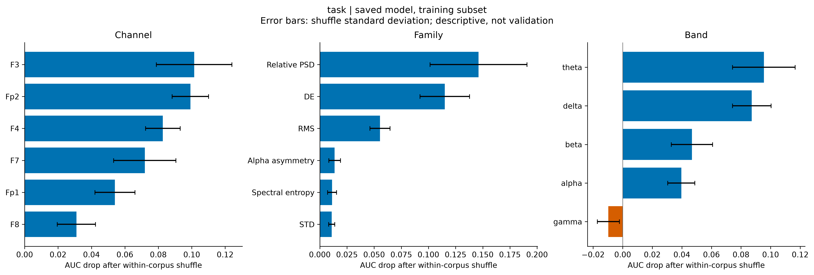
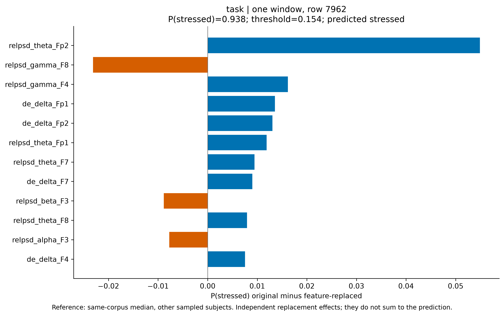
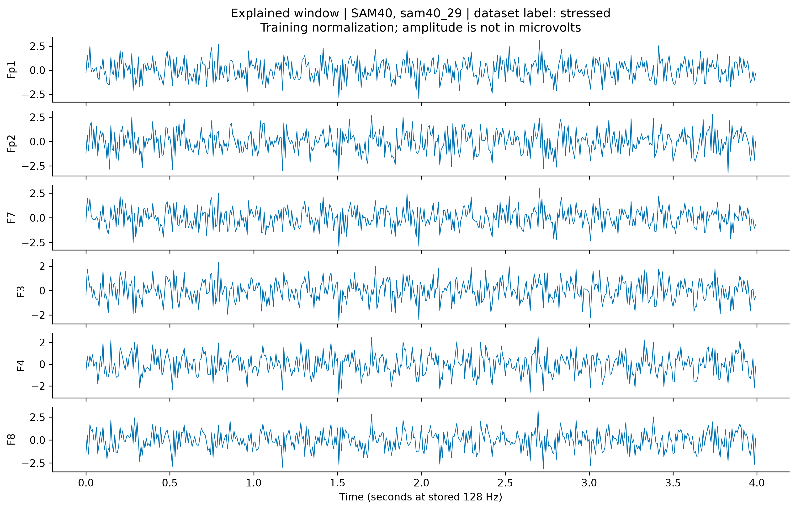

# Screening model explanations

These explain existing fitted models on sampled **training data**. No models were trained. Sample AUC and permutation drops are descriptive, not estimates of performance on new subjects or devices.

Four windows per (corpus, subject), seed 42; five shuffles per group. Shuffles stay within each corpus and move all group columns together. Positive AUC drops indicate reliance on that group in this sample; negative drops mean shuffling improved ranking. Error bars are shuffle standard deviations, not subject-level confidence intervals.

Feature dependencies remain a limitation: group replacement can create combinations outside the training distribution. Channel groups overlap because each FAA pair belongs to both channels. Band groups contain only relative PSD and DE. Importances across groups do not add up.

The legacy SAM40 windows used by these saved models have a documented sampling-rate error. Their band labels and time axis inherit that error; this run does not rebuild the data. Screen/task explanations can also reflect corpus acquisition differences. The task model's existing CV accuracy is below its majority baseline; explanations do not establish model quality or clinical biomarkers.

Method reference: [scikit-learn permutation importance](https://scikit-learn.org/stable/modules/permutation_importance.html).

## resting: depressed

Model: `models/resting_healthy_vs_depressed.joblib`. Explained sample: 212 windows from 53 subjects. Sample AUC (training subset): 1.0000.

Existing subject-grouped CV, copied from the saved artifact: AUC 0.7536, accuracy 0.6542, majority 0.5478. These CV metrics were not recomputed by this explanation run.

| Group type | Largest AUC drop | Mean ± shuffle SD |
|---|---|---:|
| channel | F4 | +0.1050 ± 0.0172 |
| family | DE | +0.2369 ± 0.0157 |
| band | gamma | +0.0106 ± 0.0035 |

Local example: source row 13, MODMA, subject `modma_2030020`. Dataset label **healthy**; model predicts **healthy** (P=0.000, threshold=0.685). The first sampled window is chosen without selecting for correctness or confidence.

Local bars are P(original) minus P(one feature replaced by the same-corpus median from other sampled subjects). Positive bars support the positive class relative to this reference. These are independent sensitivity effects, **not SHAP values**, and do not sum to the prediction.

[Full numbers and input hashes](resting/explanation.json) · [Global CSV](resting/global_importance.csv) · [Local CSV](resting/local_feature_effects.csv) · [Sample predictions](resting/sample_predictions.csv)

## screen: ill

Model: `models/screen_healthy_vs_ill.joblib`. Explained sample: 432 windows from 108 subjects. Sample AUC (training subset): 0.9574.

Existing subject-grouped CV, copied from the saved artifact: AUC 0.6527, accuracy 0.5997, majority 0.5783. These CV metrics were not recomputed by this explanation run.

| Group type | Largest AUC drop | Mean ± shuffle SD |
|---|---|---:|
| channel | F4 | +0.1132 ± 0.0056 |
| family | DE | +0.1822 ± 0.0100 |
| band | delta | +0.0948 ± 0.0070 |

Local example: source row 13, MODMA, subject `modma_2030020`. Dataset label **healthy**; model predicts **healthy** (P=0.011, threshold=0.044). The first sampled window is chosen without selecting for correctness or confidence.

Local bars are P(original) minus P(one feature replaced by the same-corpus median from other sampled subjects). Positive bars support the positive class relative to this reference. These are independent sensitivity effects, **not SHAP values**, and do not sum to the prediction.

[Full numbers and input hashes](screen/explanation.json) · [Global CSV](screen/global_importance.csv) · [Local CSV](screen/local_feature_effects.csv) · [Sample predictions](screen/sample_predictions.csv)

## task: stressed

Model: `models/task_healthy_vs_stressed.joblib`. Explained sample: 220 windows from 55 subjects. Sample AUC (training subset): 0.8201.

Existing subject-grouped CV, copied from the saved artifact: AUC 0.5982, accuracy 0.6590, majority 0.7076. These CV metrics were not recomputed by this explanation run.

| Group type | Largest AUC drop | Mean ± shuffle SD |
|---|---|---:|
| channel | F3 | +0.1014 ± 0.0226 |
| family | Relative PSD | +0.1462 ± 0.0446 |
| band | theta | +0.0955 ± 0.0211 |

Local example: source row 7962, SAM40, subject `sam40_29`. Dataset label **stressed**; model predicts **stressed** (P=0.938, threshold=0.154). The first sampled window is chosen without selecting for correctness or confidence.

Local bars are P(original) minus P(one feature replaced by the same-corpus median from other sampled subjects). Positive bars support the positive class relative to this reference. These are independent sensitivity effects, **not SHAP values**, and do not sum to the prediction.

[Full numbers and input hashes](task/explanation.json) · [Global CSV](task/global_importance.csv) · [Local CSV](task/local_feature_effects.csv) · [Sample predictions](task/sample_predictions.csv)
